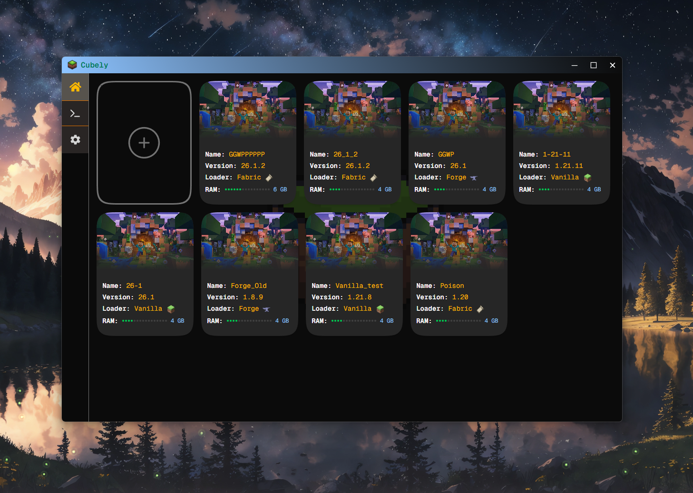
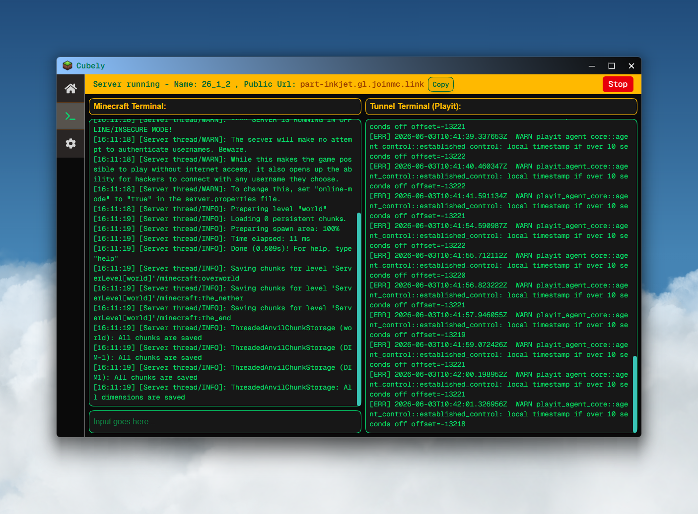
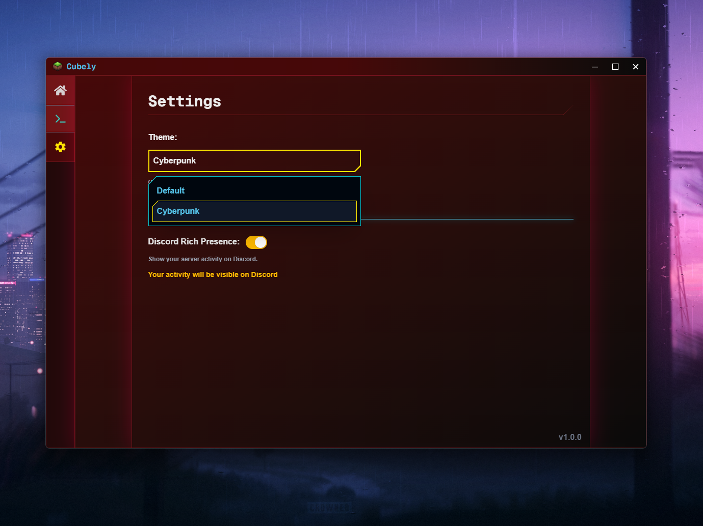
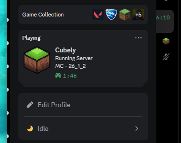

<div align="center">


# Cubely

**A clean, lightweight desktop Minecraft server manager built with Tauri, Rust, and Next.js.**

Create Vanilla, Fabric, or Forge servers in clicks — with automatic Java management, dual live terminals, built-in Playit.gg tunneling, and Discord Rich Presence.

[](https://github.com/Kilaparthi-Himanshu/cubely/releases/latest)
[](https://github.com/Kilaparthi-Himanshu/cubely/releases/download/v1.0.0/cubely_1.0.0_x64-setup.exe)
[](https://tauri.app/)
[](https://nextjs.org/)

[**Download v1.0.0 for Windows (x64)**](https://github.com/Kilaparthi-Himanshu/cubely/releases/download/v1.0.0/cubely_1.0.0_x64-setup.exe) · [**Releases**](https://github.com/Kilaparthi-Himanshu/cubely/releases) · [**Report a Bug**](https://github.com/Kilaparthi-Himanshu/cubely/issues)

</div>

---

## Features

- **One-Click Server Creation** — Spin up isolated **Vanilla**, **Fabric**, or **Forge** Minecraft servers across classic and latest versions (from `1.8.9` through `1.21.x` and `26.x`) with a visual RAM slider (`1–16 GB`).
- **Automatic Java Management** — Never hunt for the right JDK again. Cubely automatically downloads, verifies, and matches the required Java runtime for each Minecraft version.
- **Built-In Playit.gg Tunneling** — Toggle tunneling directly in Server Settings to share a public `*.gl.joinmc.link` address with friends — no router port forwarding needed.
- **Dual Live Terminals** — Monitor your interactive Minecraft server console (with command input) side by side with Playit.gg tunnel logs, plus a top banner with one-click URL copy and clean server stop.
- **Visual `server.properties` Editor** — Configure world name (with live world detection), MOTD, gamemode, force gamemode, difficulty, PvP, online/offline mode, max players, spawn protection, view/simulation distance, and server port without manually editing text files.
- **Discord Rich Presence** — Optionally broadcast your running server and uptime directly on your Discord profile.
- **Custom Themes & Auto-Updates** — Switch between the clean **Default** dark theme and the neon **Cyberpunk** theme, with built-in passive auto-updates via Tauri.

---

## Automatic Java Compatibility

Cubely selects and installs the right Java version automatically based on your server's Minecraft version:

| Minecraft Version | Java Runtime Installed |
| :--- | :--- |
| `1.0` – `1.16.x` | **Java 8** |
| `1.17` – `1.20.x` | **Java 17** |
| `1.21+` | **Java 21** |
| `26.x+` | **Java 25** |

---

## Download & Installation

1. Download the latest Windows installer:
   - [**cubely_1.0.0_x64-setup.exe**](https://github.com/Kilaparthi-Himanshu/cubely/releases/download/v1.0.0/cubely_1.0.0_x64-setup.exe)
2. Run the setup executable and launch **Cubely**.

> **Note on Windows SmartScreen:** Because Cubely is an independent open-source app without a paid code-signing certificate yet, Windows SmartScreen may show a warning on first launch. Click **More info → Run anyway** to proceed.

---

## Using the Playit.gg Tunnel Feature (One-Time Setup)

Cubely launches Playit.gg automatically and displays your public join address in the active server banner, as long as your Playit tunnel is configured beforehand:

1. Create a free account at [playit.gg](https://playit.gg) and link the Playit agent on your Windows PC once (this creates your local `playit.toml` config).
2. In your Playit.gg dashboard, add a **Minecraft Java** tunnel pointing to the default local port **`25565`** (`127.0.0.1:25565`).
3. Inside Cubely, open **Server Settings**, keep **Server Port** on `25565`, and enable **Tunnel (Playit.gg)**.
4. Start your server — Cubely will boot the Playit tunnel alongside Minecraft and show your copyable `*.gl.joinmc.link` address at the top.

---

## Screenshots

> *(Tip: Drag & drop your 4 screenshots directly into GitHub's README editor or commit them to a `docs/` folder and update the paths below.)*

| Dashboard | Dual Terminals |
| :---: | :---: |
|  |  |

| Cyberpunk Settings | Discord Rich Presence |
| :---: | :---: |
|  |  |

---

## Tech Stack

- **Desktop Core:** [Tauri v2](https://tauri.app/) & [Rust](https://www.rust-lang.org/)
- **Frontend:** [Next.js 16](https://nextjs.org/), [React 19](https://react.dev/), [Tailwind CSS v4](https://tailwindcss.com/)
- **State & Motion:** [Jotai](https://jotai.org/), [Framer Motion](https://www.framer.com/motion/)
- **Package Manager:** [Bun](https://bun.sh/)

---

## Building from Source

### Prerequisites
- [Rust & Cargo](https://rustup.rs/)
- [Bun](https://bun.sh/) (or Node.js)
- [Tauri v2 Windows prerequisites](https://v2.tauri.app/start/prerequisites/)

### Run Locally
```bash
git clone https://github.com/Kilaparthi-Himanshu/cubely.git
cd cubely
bun install
bun run tauri dev
```

### Build Production Installer
```bash
bun run tauri build
```

---

## Disclaimer

Cubely is not an official Minecraft product and is not approved by or associated with Mojang or Microsoft.